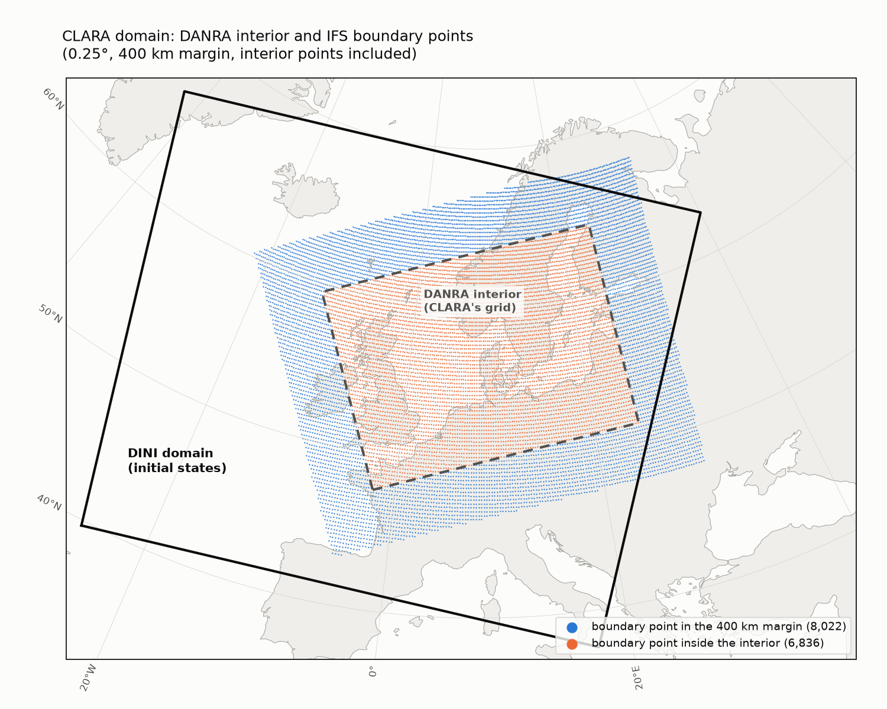
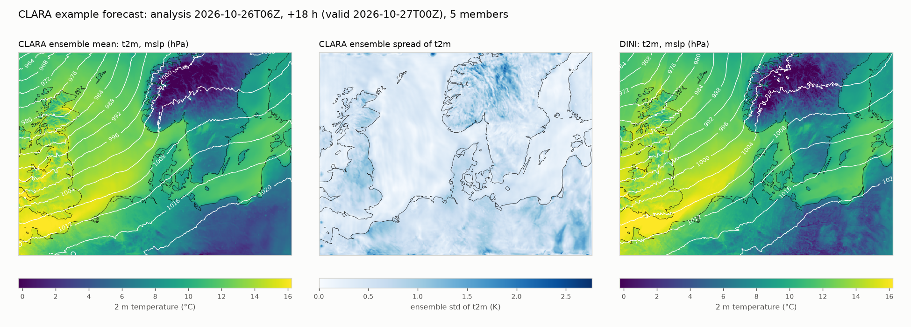
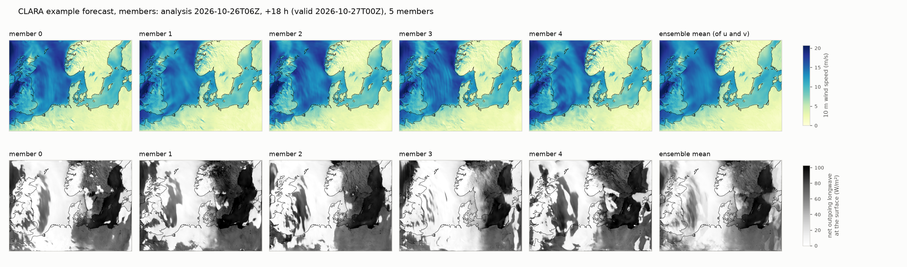
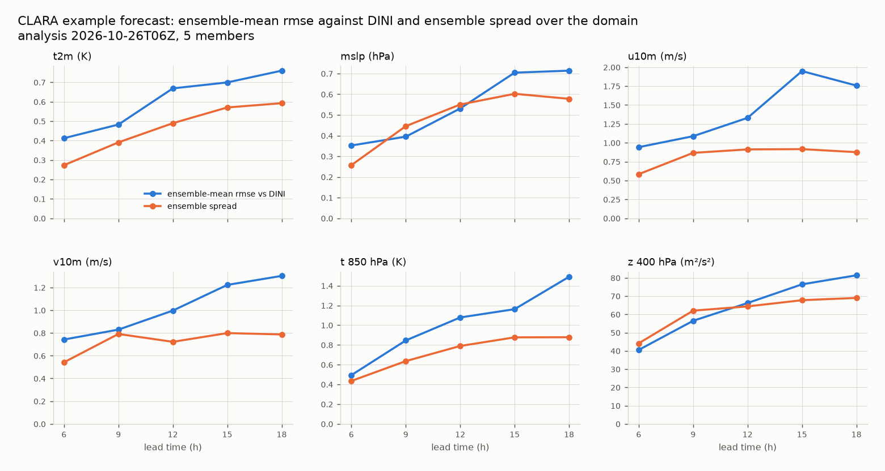

# mlwp-inference-container-clara

> **Status: pre-release.** The pipeline runs end to end. The inference
> artifact with the full training statistics is still to be built and
> published; see [PLAN.md](PLAN.md) for what is done and what remains.

This repository builds the inference container images for **CLARA**,
**C**RPS-**LA**M **R**apid **A**tmospheric ensembles. CLARA runs **CRPS-LAM**
operationally. "Rapid" refers to the model's main strength: each ensemble
member is generated in a single forward pass, about 39× faster than diffusion
baselines. CRPS-LAM is the probabilistic machine-learning limited-area model
of Larsson et al. (2025), ["CRPS-LAM: Probabilistic Regional Weather
Forecasting with Continuous Ranked Probability
Score"](https://arxiv.org/abs/2510.09484).

- **Interior initial states:** **DINI**, regridded to the DANRA grid.
- **Boundary:** **IFS** forecasts.
- **Output:** an **ensemble forecast**.

**Model architecture:** a hybrid GNN/UNet backbone, neural-lam `crps` with
backbone `graph_unet2` and graph `feature_map_graph_198x148`. A noise vector
is injected at every step, so each ensemble member is drawn in a single
forward pass. It was trained with a CRPS loss.

**Training data:**
- **Interior:** DANRA, 2.5 km and 3-hourly.
- **Boundary:** first ERA5, then fine-tuned on IFS forecasts, on a 400 km
  margin around the DANRA domain.

Everything needed for that is in one Python project
([pyproject.toml](pyproject.toml), with the exact environment in `uv.lock`):
- **Inference pipeline:** `src/clara_inference/`, run by
  `python -m clara_inference`, which is the image's entrypoint.
- **Image build:** the [Containerfile](Containerfile) and
  [scripts/build_image.sh](scripts/build_image.sh).
- **Artifact tools:** the tools that build the model's *inference artifact*
  (configs, training statistics, grids, graph, checkpoint; see below), in
  `src/clara_inference/artifact/`.

The design follows
[`dmidk/mlwp-inference-container-anna`](https://github.com/dmidk/mlwp-inference-container-anna)
(ANNA, the deterministic DANRA model). Much of the code is shared with it,
including the option/environment convention, checkpoint fetching, DINI
regridding and the S3 upload.

## Model

The model is described in
[artifact/configs/model.yaml](artifact/configs/model.yaml): the checkpoint,
the graph, the neural-lam arguments and the training neural-lam config.

**Paper:** E. Larsson, J. Oskarsson, T. Landelius, F. Lindsten,
[arXiv:2510.09484](https://arxiv.org/abs/2510.09484).

**Checkpoint:** `CRPS_IFS_ALL_FINETUNE_AR12-train-crps-4x330-05_21_13-3613`.
- wandb project `real_prob_lam`, run `CRPS_IFS_ALL_FINETUNE_AR12`, epoch 92.
- Fine-tuned with 12-step rollouts and an IFS boundary, starting from
  `CRPS_IFS_ALL_FINETUNE-train-crps-4x330-05_20_08-5709`.
- About 251 M parameters, trained in `bf16-mixed`.

**Key settings.** These are all the checkpoint arguments that affect the
model and differ from `train_model`'s defaults:

| Setting | Value |
|---|---|
| Model / backbone | `--model crps --backbone_model graph_unet2` |
| Widths | `--hidden_dim 330 --hidden_dim_grid 270 --hidden_dim_mesh_nodes 270 --hidden_dim_edge 32` |
| UNet | `--channel_mult 1 1 1 1 1 1 --attn_res 10 18 36 70` |
| Noise | `--noise_dim 32 --noise_embedding linear` |
| Prediction | `--pred_residual`, `--precision bf16-mixed` |
| Ensemble | `--ensemble_size` is configurable (default 5) |

**Training code:** neural-lam from
[`leifdenby/real-prob-lam`](https://github.com/leifdenby/real-prob-lam)
(`neural-lam-dev-building-ml-lams/`), a fork of `joeloskarsson/neural-lam-dev`.

## Software

Pinned in [pyproject.toml](pyproject.toml):

- **neural-lam:** `leifdenby/real-prob-lam@d96b972` (subdirectory
  `neural-lam-dev-building-ml-lams`, branch `prob-model-inference`). This
  repository is private, see [Building the image](#building-the-image). The
  branch adds:
  - the bf16 and single-GPU inference fixes;
  - `NEURAL_LAM_STRICT_LOAD=1`, which makes loading a checkpoint fail instead
    of silently keeping randomly initialised weights for missing or
    mismatched parameters. The pipeline always sets it;
  - `NEURAL_LAM_SKIP_TEST_METRICS=1`, which skips the test-epoch metrics and
    plots (there are no real targets in inference).
- **mllam-data-prep:** `Erik-Wikingsson/mllam-data-prep-real@0589539`
  (`rect-boundary`, with `latlon-domain-crop`), as used for training.
- **torch 2.12** (CUDA 13.0 index) in the uv environment. The image uses its
  base image's torch.
- **zarr 2**, as in training.

## Domain



- **Interior:** the full DANRA grid, 2.5 km Lambert conformal with 589 × 789
  points. Initial states are regridded to it from DINI.
- **Boundary:** 14,858 points of the 0.25° grid within 400 km of the
  interior. Unlike ANNA's boundary ring, the points *inside* the interior
  (orange) are included too. All of them come from IFS, so, unlike ANNA's DINI
  boundary, there is no coverage gap.

The figure is made with `dev-utils/plot_domain.py`.

## Example forecast

The forecast: analysis 2026-10-26T06Z, +18 h, 5 members, run on a DGX Spark.
- Initial states are from DINI; the boundary is IFS open data from the 00Z cycle (made with `dev-utils/make_ifs_boundary_zarr.py`).
- It's compared with the DINI forecast from the same analysis, regridded to the DANRA grid. DINI is a forecast too, not the truth, so the RMSE shows how far apart the two models are.

> **Interim statistics.** This forecast was normalised with the statistics from ANNA's artifact (`dev-utils/stats_from_anna.py`). They have the same features and are computed the same way, but over ANNA's training period (2000-01-01 → 2018-10-29). CLARA's own were computed over 2016-01-01 → 2019-10-22, as recorded in the checkpoint.
>
> The figures show the model's unclipped outputs. Relative humidity and night-time short-wave radiation are partly outside their physical ranges, as the model doesn't constrain them; see [Post-processing](#post-processing-off-by-default).





DANRA, and so CLARA, has no top-of-atmosphere OLR. The longwave row shows the net longwave at the surface instead, sign-flipped so that it is positive upwards. Clouds keep it small, so it looks a little like a satellite image. The members differ more in their clouds than in their winds.



At +18 h the ensemble-mean RMSE against DINI is:
- t2m: 0.76 K
- mslp: 0.7 hPa
- 10 m wind components: 1.3–1.8 m/s

The ensemble spread grows with lead time and is close to the RMSE, a little below it.

The figures are made with `dev-utils/plot_example_forecast.py`, and the numbers come from `dev-utils/check_forecast_output.py`.

## Configs

The trained model was set up with these configs, in
[artifact/configs/](artifact/configs/) (with the training cluster's paths
replaced by the public sources, or by placeholders set at inference):

| File | What |
|---|---|
| `danra_model_config_ifs_all.yaml` | the neural-lam config the model was trained with: state feature weights, clamping of `r` to [0, 1] |
| `danra_model1_config_ifs_finetune.yaml` | interior (DANRA) datastore, PT3H. 55 state features: pres_seasurface, t2m, u10m, v10m, pres0m, lwavr0m, swavr0m, and z/t/r/u/v/tw at 100–1000 hPa. Statics lsm, orography; forcings toa_radiation and time of day/year |
| `overlapping_ifs_all2_400km_model1_config.yaml` | boundary (IFS forecast) datastore. Forecast layout `analysis_time × elapsed_forecast_duration` with lead times every 6 h, 400 km margin (14,858 points of the 0.25° grid), 58 forcing features with ERA5 names, ERA5 statics |
| `danra_model1_config.yaml` | the interior statistics datastore (DANRA, 2016-01-01 → 2019-10-22) |
| `overlapping_era_400km_model1_config.yaml` | the boundary statistics datastore (ERA5, same period): the IFS boundary is normalised with ERA5 statistics (`overload_stats_path`) |

## Inference artifact

An **inference artifact** is a directory, shipped as a zip, that holds
everything needed to run a trained model's forecasts apart from the input data
and the software. See ANNA's README for the concept. The layout is described
in [layout.py](src/clara_inference/artifact/layout.py), and the README shipped
in the zip is [artifact/package-README.md](artifact/package-README.md).

| Path | What |
|---|---|
| `configs/` | the training configs above and `model.yaml` |
| `configs/<stats datastore>.zarr` | next to the two statistics datastore configs: the training statistics, which neural-lam reads for `overload_stats_path` |
| `grids/` | the DANRA grid and statics (target grid for regridding DINI), and the boundary grid with the ERA5 statics |
| `graphs/feature_map_graph_198x148/` | the graph the model was trained with (not rebuilt at run time) |
| `artifact.yaml`, `README.md` | provenance and description |
| `clara_model.ckpt` | the sanitized checkpoint (1.0 GB): weights, plus `args` and `config` as plain dicts. No optimizer state or pickled training datastores, so it loads with `weights_only=True` |

### Training statistics

**The normalisation statistics are not in the checkpoint.** neural-lam registers them as non-persistent buffers, and the training statistics only existed on the training cluster. They are recomputed from public data over CLARA's training split, **2016-01-01 → 2019-10-22**.

The period is recorded in the checkpoint's pickled copy of the ERA5 statistics datastore. It is not the paper's (and ANNA's) 2000-01-01 → 2018-10-29, which was used for pretraining only.

Two tools compute the statistics exactly as mllam-data-prep does:
- **mean and std** of the values;
- **mean of the first** time differences;
- **std of the second** time differences. This is what mllam-data-prep's `calc_stats` actually computes for `diff_std`.

| Tool | Datastore | Source | Reads |
|---|---|---|---|
| [`danra_stats`](src/clara_inference/artifact/danra_stats.py) | `danra_model1_config` (interior: state, forcing, static) | DANRA v0.5.0 on the ECMWF object store | ~540 GB |
| [`era5_boundary_stats`](src/clara_inference/artifact/era5_boundary_stats.py) | `overlapping_era_400km_model1_config` (boundary: forcing, static) | WeatherBench2 ERA5 | ~1.9 TB |

`era5_boundary_stats` is ported from ANNA's tool. mllam-data-prep computes the statistics **before** the domain cropping, so they cover the whole ERA5 subset box the training datastore was built from (`era_danra_model1_subset.zarr`, 187 × 267 points), not just the 400 km margin.

How the tools run:
- Both stream the split in blocks.
- They save each finished block to `--partials-dir`, so rerunning the same command after an interruption picks up where it stopped.
- They retry reads that fail on network errors.
- `danra_stats` aligns its blocks with DANRA's 32-day time chunks, so each chunk is downloaded once. It downloads them into a temporary cache under `--cache-dir`, about 12 GB per chunk (52 GB uncompressed).

On test periods both match mllam-data-prep: ERA5 to within 1e-13 and DANRA to within 1e-8 of each feature's spread.

Statistics from only a few days are **unusable**. The day-of-year forcings then have a std close to 0, which puts their standardised values at about −1600σ, and the forecast diverges.

#### Recomputing them on a machine with good bandwidth

This takes hours even on a fast connection; a 60 MB/s link would need more than a day. The two runs are independent and can run at the same time.

```bash
git clone git@github.com:leifdenby/mlwp-inference-container-clara.git
cd mlwp-inference-container-clara
uv sync   # needs GitHub access to leifdenby/real-prob-lam (neural-lam)

# check the setup first: a few time steps only, logs what the full run reads
# (ERA5: ~2.8 GB; DANRA: one 32-day time chunk of every variable, ~12 GB)
uv run python -m clara_inference.artifact.era5_boundary_stats --dry-run \
    --output dry-run/overlapping_era_400km_model1_config.zarr \
    --partials-dir dry-run/partials-era5
uv run python -m clara_inference.artifact.danra_stats --dry-run \
    --output dry-run/danra_model1_config.zarr \
    --partials-dir dry-run/partials-danra --cache-dir dry-run/cache

# the full runs (rerun the same command to resume)
uv run python -m clara_inference.artifact.era5_boundary_stats \
    --output stats/overlapping_era_400km_model1_config.zarr \
    --partials-dir partials-era5
uv run python -m clara_inference.artifact.danra_stats \
    --output stats/danra_model1_config.zarr \
    --partials-dir partials-danra --cache-dir danra-cache
```

The resulting `stats/` directory is a few MB. Copy it back and pass it to `assemble --stats-dir` (below).

Until the exact statistics are in, `dev-utils/stats_from_anna.py` makes interim ones from ANNA's artifact. They have the same features, source box and method, but ANNA's period.

### Building the artifact

```bash
# artifact/build/stats: the two statistics zarrs (see above)
# the artifact (DANRA grid from the object store, ERA5 statics from WB2)
uv run python -m clara_inference.artifact.assemble \
    --output artifact/build/clara-local \
    --checkpoint <training checkpoint>/last.ckpt \
    --graph <...>/feature_map_graph_198x148.zip \
    --stats-dir artifact/build/stats --zip artifact/build/clara-local.zip
```

`assemble` derives the boundary grid from the graph's boundary nodes, and
checks the artifact before finishing (`layout.check_artifact`).

### Publishing on Zenodo

As for ANNA, the model checkpoint and the inference package are **separate Zenodo records**. The package's `model.yaml` refers to the checkpoint by DOI, URL and md5. The image downloads both: the package from `PACKAGE_URL`, then the checkpoint from `model.yaml`.

[`zenodo_draft`](src/clara_inference/artifact/zenodo_draft.py) creates or updates **drafts only**: it never publishes. You review the drafts, share them and publish them in the Zenodo web UI. The token, with scope `deposit:write`, is read from `--token-file` or from `ZENODO_TOKEN`.

1. **Checkpoint.** Sanitizing is deterministic, so the checkpoint from any `assemble` run can be uploaded. Zenodo reserves its DOI with the draft, and the tool prints the `model.yaml` fields to fill in. After that, `assemble` checks that the checkpoint it sanitizes has the published md5.
   ```bash
   uv run python -m clara_inference.artifact.zenodo_draft --kind checkpoint \
       --file artifact/build/clara-local/clara_model.ckpt --dry-run   # metadata only
   uv run python -m clara_inference.artifact.zenodo_draft --kind checkpoint \
       --file artifact/build/clara-local/clara_model.ckpt --token-file ~/.zenodo-token
   ```
2. **Package.** Assemble the artifact with the full training statistics and the filled-in `model.yaml`, then:
   ```bash
   uv run python -m clara_inference.artifact.zenodo_draft --kind package \
       --file artifact/build/clara-local.zip --token-file ~/.zenodo-token
   ```
   The tool refuses a package with placeholder statistics, or one whose `model.yaml` has no checkpoint DOI. After publishing, it prints the `PACKAGE_URL` and `PACKAGE_MD5` for the image build.

Rehearse either step on sandbox.zenodo.org with `--sandbox` and a sandbox token.

## Building the image

```bash
CONTAINER_APP=docker scripts/build_image.sh
```

The image is tagged `mlwp-inference-container-clara:latest` (`IMAGE_NAME`).

- **Token.** neural-lam is installed from the private `leifdenby/real-prob-lam`.
  The build needs a GitHub token: `GITHUB_TOKEN`, or the one from
  `gh auth login`. It is passed as a BuildKit secret, never as a build
  argument, so it doesn't end up in the image.
- **torch.** The install uses the base image's torch, not the cu130 index of
  the uv environment. The git pins of `pyproject.toml` are passed to
  `uv pip install --no-sources` by
  [scripts/container_pins.py](scripts/container_pins.py).
- **`ARTIFACT_SOURCE=local`** (default) uses an assembled artifact directory,
  `LOCAL_ARTIFACT_DIR` (default `artifact/build/clara-local`).
- **`ARTIFACT_SOURCE=release`** downloads the package zip from `PACKAGE_URL`
  (e.g. its Zenodo record) and checks it against `PACKAGE_MD5`.
- **Checkpoint.** It is downloaded and md5-checked from `model.yaml`'s url
  (its Zenodo record), unless the artifact already has it.
- **Token.** The GitHub token is only ever sent to GitHub: for
  `real-prob-lam`, and for any `api.github.com` release asset URL.

**CI** ([container-image.yml](.github/workflows/container-image.yml)) builds
the x86_64 image on every push and pull request. `v*` tags also publish it as
`ghcr.io/leifdenby/mlwp-inference-container-clara:<tag>` and `:latest`. It
needs:
- the repository secret `REAL_PROB_LAM_TOKEN`: a fine-grained token with read
  access to the contents of `leifdenby/real-prob-lam` (neural-lam);
- the variables `PACKAGE_URL` and `PACKAGE_MD5`.

Without them, the build is skipped.

## Running a forecast

`python -m clara_inference` runs the whole pipeline. It is also installed as
`clara-inference`, which is the image's entrypoint. Each step runs as a
subprocess:

1. **`clara_inference.regrid_dini`:** regrids DINI to the DANRA grid at
   3-hourly steps.
2. **`clara_inference.create_inference_dataset`:** builds the inference
   datastores and the neural-lam config.
   - The interior is normalised with the DANRA training statistics.
   - The boundary uses the selected IFS cycle on the boundary grid, normalised
     with the ERA5 training statistics.
   - It checks the boundary points against the graph's boundary nodes, and
     that the statistics' features match the datastores' features in order.
   - The artifact's graph is linked in.
3. **`neural_lam.train_model --eval test`:** runs the ensemble forecast with
   strict checkpoint loading.
4. **`clara_inference.convert_output`:** writes DANRA-like output datasets
   with an `ensemble_member` dimension. Optionally it also clips two
   variables to their physical ranges. That is post-processing, off by
   default; see below.
5. **`clara_inference.upload_outputs`:** optionally uploads to S3.

A 5-member forecast of 18 h runs the model in about 2 minutes on a DGX Spark
(GB10). The whole run in the container takes about 7.5 minutes, most of it
regridding DINI, i.e. downloading it from S3.

```bash
uv run python -m clara_inference --artifact-path artifact/build/clara-local \
    --analysis-time 2026-10-26T06:00Z --forecast-duration PT18H \
    --ifs-boundary-path dev-data/ifs/2026-10-26T000000Z/ifs.zarr
# in the container
CONTAINER_APP=docker CLARA_IFS_BOUNDARY_PATH=dev-data/ifs/2026-10-26T000000Z/ifs.zarr \
    scripts/run_inference_container.sh 2026-10-26T06:00Z PT18H
```

### Post-processing (off by default)

CLARA's outputs are, by default, **exactly what the model predicts**.

The model doesn't constrain any variable to a physical range. The training config has an `output_clamping` section, but the `crps` model doesn't apply it, neither in training nor here. So the outputs can go out of range. In the example forecast below (5 members, +6 h to +18 h):
- **Net surface short-wave radiation `swavr0m`** is slightly negative at night at 31% of the values. The median of those is −4 W/m²; 0.5% go below −20 W/m², and the lowest is −104 W/m².
- **Relative humidity `r`** is above 1 at 5–12% of the points at 400–925 hPa, mostly by less than 0.05 (saturated air). It is below 0 at up to 3% (600 hPa). The extremes are −0.48 and 2.35.

`--clip-to-physical-ranges` (`CLARA_CLIP_TO_PHYSICAL_RANGES=true`) clips:
- `r` to [0, 1];
- `swavr0m` to ≥ 0.

This is **post-processing, applied after the model has made its predictions**:
- It only changes the output datasets (`outputs/single_levels.zarr`, `outputs/pressure_levels.zarr`).
- It doesn't change the forecast itself. The model's autoregressive steps use the unclipped values.
- neural-lam's raw prediction (`outputs/prediction.zarr`) stays unclipped.

When enabled, the outputs' `postprocessing` attribute records what was clipped.

**S3 access.** S3 inputs are read with the usual AWS configuration. Without
any AWS credentials they are read anonymously, which works for DINI's public
`harmonie-zarr` bucket.

### Configuration

Every command-line option `--some-option` can also be set with the
environment variable `CLARA_SOME_OPTION`. The command line wins over the
variable, which wins over the default. This is the same convention as ANNA
(`envargs.py`).

| Option | Environment variable | Default | |
|---|---|---|---|
| `--analysis-time` | `CLARA_ANALYSIS_TIME` | (required) | DINI analysis time, ISO8601, e.g. `2026-10-01T06:00Z` |
| `--forecast-duration` | `CLARA_FORECAST_DURATION` | `PT18H` | multiple of 3 h, at least 12 h |
| `--ensemble-size` | `CLARA_ENSEMBLE_SIZE` | `5` | number of ensemble members |
| `--ifs-boundary-path` | `CLARA_IFS_BOUNDARY_PATH` | (required) | IFS forecast zarr following the contract below (local or S3) |
| `--dini-root` | `CLARA_DINI_ROOT` | `s3://harmonie-zarr/dini/control/{analysis}/` | DINI forecast zarrs |
| `--workdir` | `CLARA_WORKDIR` | `inference_workdir` | working directory; outputs go in `outputs/` |
| `--artifact-path` | `CLARA_ARTIFACT_PATH` | `inference_artifact` | the inference artifact, including the checkpoint |
| `--skip-completed` | `CLARA_SKIP_COMPLETED` | `false` | skip the stages already completed in the workdir |
| `--clip-to-physical-ranges` | `CLARA_CLIP_TO_PHYSICAL_RANGES` | `false` | **post-processing**, after the model's predictions: clip `r` to [0, 1] and `swavr0m` to ≥ 0 in the outputs (see [Post-processing](#post-processing-off-by-default)) |
| `--output-s3-prefix` | `CLARA_OUTPUT_S3_PREFIX` | | also upload the outputs to `{prefix}/<analysis time>/`, replacing an earlier upload for that analysis time |
| `--input-s3-endpoint-url` | `CLARA_INPUT_S3_ENDPOINT_URL` | (AWS config) | S3 endpoint for reading DINI and IFS |
| `--input-aws-profile` | `CLARA_INPUT_AWS_PROFILE` | (AWS config) | AWS profile for reading DINI and IFS |
| `--output-s3-endpoint-url` | `CLARA_OUTPUT_S3_ENDPOINT_URL` | (AWS config) | S3 endpoint for the upload (needs `--output-s3-prefix`) |
| `--output-aws-profile` | `CLARA_OUTPUT_AWS_PROFILE` | (AWS config) | AWS profile for the upload (needs `--output-s3-prefix`) |
| `--debugger` | `CLARA_DEBUGGER` | | `ipdb` to debug the python steps on exceptions |
| `--log-level` | `CLARA_LOG_LEVEL` | `INFO` | loguru level |

### IFS boundary contract

The IFS boundary is not downloaded by the container. It is given as a zarr
(`--ifs-boundary-path`) in the layout the model was fine-tuned on. The
contract is checked by [ifs_boundary.py](src/clara_inference/ifs_boundary.py):

- **Dimensions:** `time` (forecast cycle) and `prediction_timedelta` (lead
  time, **every 6 h** from 0 h), plus `longitude` and `latitude` on the 0.25°
  WeatherBench2 grid. Either longitude convention and either latitude order
  is accepted. Pressure-level variables also have `level` (hPa).
- **Coverage:** the 400 km margin around the DANRA domain (lat 43.25–67.75,
  lon −22–44).
- **Variables**, with ERA5 names and units:
  - single level: `mean_sea_level_pressure`, `2m_temperature`,
    `10m_u_component_of_wind`, `10m_v_component_of_wind`, `surface_pressure`;
  - pressure level: `geopotential`, `temperature`, `specific_humidity`,
    `u_component_of_wind`, `v_component_of_wind`, `vertical_velocity`, at
    100, 200, 400, 600, 700, 850, 925 and 1000 hPa.
- **Cycle selection:** the **latest 00/12 UTC cycle at or before the analysis
  time − 3 h**, which is the cycle neural-lam used in training. For example:
  - 06Z → 00Z;
  - 12Z → 00Z;
  - 18Z → 12Z;
  - 00Z → 12Z of the previous day.

  Its lead times must cover the forecast plus two 6 h steps.

**Point order.** The graph connects the boundary nodes by index, so the
boundary points must be in training order:
- longitude 0–360, increasing;
- within a longitude, latitude decreasing.

The IFS fields are therefore put on the artifact's boundary grid, which is in
that order, and the resulting boundary points are checked against the graph.

[dev-utils/make_ifs_boundary_zarr.py](dev-utils/make_ifs_boundary_zarr.py)
makes such a zarr from ECMWF open data. Open data is kept for a few days only.

### Outputs and conventions

The outputs are `<workdir>/outputs/single_levels.zarr` and
`pressure_levels.zarr`.
- **Grid:** the DANRA grid.
- **Times:** valid times T+6 h … T+duration in 3 h steps. The initial states
  are DINI at T+0 and T+3 h.
- **Ensemble:** an `ensemble_member` dimension, chunked per member and
  valid time.

The conventions are DANRA's, as for ANNA:
- winds are relative to the DANRA Lambert grid;
- `r` is a fraction (0–1);
- `lwavr0m`/`swavr0m` are net surface fluxes;
- `tw` is geometric vertical velocity.

The data carries CF grid-mapping metadata (`danra_projection`).

## Development

```bash
uv sync                          # the environment (exact versions in uv.lock)
uv run pre-commit install        # black (79), isort, flake8 on every commit
uv run pytest tests
```

`uv sync` installs neural-lam from the private `leifdenby/real-prob-lam`,
using your git credentials.

- [dev-utils/](dev-utils/):
  - `make_ifs_boundary_zarr.py`: an IFS boundary zarr from ECMWF open data;
  - `check_forecast_output.py`: sanity checks of a forecast. It reports the
    ensemble-mean RMSE and bias against DINI, and the ensemble spread, per
    valid time;
  - `plot_domain.py`: the domain figure above.
- Each pipeline step can also be run on its own, e.g.
  `uv run python -m clara_inference.create_inference_dataset --help`.

## Licence

The code is licensed under the MIT licence. The licence of the model
checkpoint and the inference package is to be decided.
